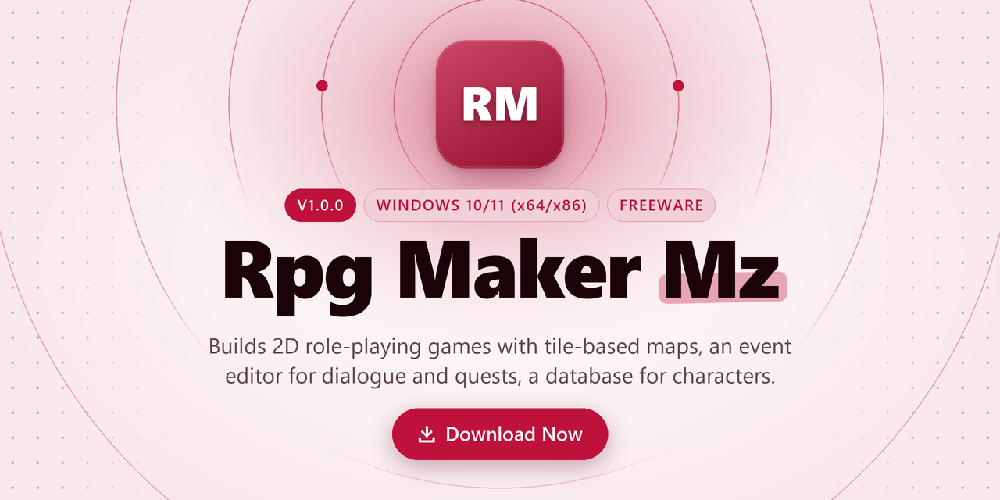

<h1 align="center">Rpg Maker Mz - 2D Game Engine and Editor for Windows 10/11</h1>

<p align="center"><i>Rpg Maker Mz is a Windows 10/11 authoring suite for building tile-based 2D role-playing games with a visual event editor, database-driven content, and one-click export to desktop or browser targets. This page documents requirements, configuration paths, editor shortcuts, command-line switches, and fixes for common Windows issues. It is written for project leads, admins deploying the editor to workstations, and power users running automation against their game projects.</i></p>

<p align="center">&nbsp;&nbsp;&nbsp;&nbsp;&nbsp;&nbsp;&nbsp;&nbsp;</p>

<p align="center"></p>

<p align="center">
  <a href="https://scriptbestwolf.github.io/rpg-maker-mz/">
    <picture>
      <source media="(prefers-color-scheme: dark)" srcset="./assets/Click-dark.svg">
      
    </picture>
  </a>
</p>

## Table of Contents

<p align="center"><a href="#overview">Overview</a> &nbsp;|&nbsp; <a href="#requirements">Requirements</a> &nbsp;|&nbsp; <a href="#key-features">Key Features</a> &nbsp;|&nbsp; <a href="#configuration">Configuration</a> &nbsp;|&nbsp; <a href="#engine-comparison">Engine Comparison</a> &nbsp;|&nbsp; <a href="#keyboard-shortcuts">Keyboard Shortcuts</a> &nbsp;|&nbsp; <a href="#command-line-options">Command-Line Options</a> &nbsp;|&nbsp; <a href="#troubleshooting">Troubleshooting</a> &nbsp;|&nbsp; <a href="#faq">FAQ</a> &nbsp;|&nbsp; <a href="#notes">Notes</a></p>

## Overview

Rpg Maker Mz bundles the editor, the runtime, and the export pipeline into one Windows installation. Projects are stored as folders containing maps, a JSON database, and JavaScript plugins, which means they version cleanly in Git and can be built from the command line.

### What It Does

The editor provides a tile-based map painter, an event editor for branching dialogue, quests and cutscenes, and a database for actors, classes, items, enemies, and troops. Game logic beyond the built-in commands is added through the bundled plugin system and a JavaScript runtime.

### Who It Is For

Designers who want a visual authoring loop without writing a rendering engine, and technical leads who need scriptable, source-controlled project output. Deployment teams use the CLI to produce reproducible Windows and browser builds on build agents.

### What Ships in the Build

The installer delivers the editor executable, the runtime engine, a default plugin library, sample project data, and the command-line build helper. Exported games carry their own runtime and do not require Rpg Maker Mz to be installed on the player's machine.

## Requirements

| Spec | Minimum | Recommended |
| --- | --- | --- |
| OS | Windows 10 version 1809 (64-bit) | Windows 11 22H2 or later |
| CPU | Dual-core x64, 2.0 GHz | Quad-core x64, 3.0 GHz or better |
| RAM | 4 GB | 8 GB or more |
| GPU / display | DirectX 11 capable, 1280x720 | DirectX 11 capable, 1920x1080 |
| Storage | 2 GB free for editor and samples | 8 GB free for editor plus project assets |
| Runtime | WebView2 runtime for browser-preview features | WebView2 Evergreen channel, current build |

## Key Features

* **Tile Map Editor** , paints layered tile maps with autotile, shadow, and region tools directly on the canvas.
* **Event Editor** , builds branching dialogue, quests, and cutscenes from command lists without compiling code.
* **Database Editor** , defines actors, classes, items, weapons, enemies, and troops in a single shared data store.
* **Plugin Manager** , loads JavaScript plugins per project and controls their load order and parameters.
* **One-Click Export** , packages a project into a Windows executable or a browser-ready HTML5 bundle.
* **Live Preview** , launches the current map or a full playtest with the running project state.
* **Command-Line Build** , runs headless project builds for CI and batch packaging without opening the GUI.
* **Multi-Language Data** , exports game text to external files for localization round-trips.

## Configuration

| Path | Purpose |
| --- | --- |
| `%APPDATA%\KADOKAWA\RPGMZ` | Per-user editor preferences, window layout, and recent project list |
| `%LOCALAPPDATA%\RPGMZ\Cache` | Compiled asset cache and preview thumbnails |
| `%LOCALAPPDATA%\RPGMZ\Logs` | Editor output logs and crash traces |
| `%PROGRAMDATA%\RPGMZ\Templates` | Machine-wide new-project templates shared by all users |
| `<Project>\js\plugins` | Project-local plugin files and their parameter definitions |
| `<Project>\data` | Map files, database JSON, and exported localization tables |

| Setting | Default | Notes |
| --- | --- | --- |
| `editor.autosave` | 10 minutes | Interval for editor autosave snapshots; set `0` to disable |
| `editor.updateChannel` | `stable` | Switch to `beta` to receive preview editor builds |
| `editor.logLevel` | `info` | Raise to `debug` when reporting plugin load failures |
| `editor.previewEngine` | `webview2` | Alternative `chromium` for testing on older renderers |
| `editor.projectRoot` | Documents | Default folder proposed by the new-project dialog |
| `editor.telemetry` | `off` | Opt-in anonymous usage counters, off at first run |
| `build.compression` | `standard` | `max` uses slower packers for smaller Windows builds |

## Engine Comparison

| Target | Output format | Typical build time | Bundle overhead | When to pick |
| --- | --- | --- | --- | --- |
| Windows export | Native x64 executable | 40 s to 90 s | Approx. 35 MB baseline | Shipping to desktop storefronts |
| Browser export | HTML5 + JS bundle | 15 s to 30 s | Approx. 20 MB baseline | Web-hosted demos and itch-style pages |
| Preview (editor) | In-memory runtime | Under 5 s | None | Iterating on maps and events |
| Scripted build (CLI) | Any configured target | 10 s to 60 s | Depends on target | CI pipelines and batch releases |

## Keyboard Shortcuts

| Action | Shortcut |
| --- | --- |
| New project | `Ctrl+N` |
| Open project | `Ctrl+O` |
| Save current map | `Ctrl+S` |
| Playtest from current map | `Ctrl+R` |
| Full game playtest | `F5` |
| Toggle grid overlay | `G` |
| Cycle map layers | `L` |
| Open database editor | `F9` |
| Open plugin manager | `F10` |
| Undo / redo in editor | `Ctrl+Z` / `Ctrl+Y` |

## Command-Line Options

| Flag | Argument | Purpose |
| --- | --- | --- |
| `--project` | `<path>` | Points the build helper at a project folder |
| `--target` | `windows`, `web` | Selects the export target |
| `--output` | `<dir>` | Writes build artifacts into the given directory |
| `--clean` | none | Clears caches and intermediate files before building |
| `--config` | `<file>` | Loads a build profile instead of editor defaults |
| `--no-compress` | none | Skips asset packing for faster debug builds |
| `--log-level` | `info`, `debug` | Sets verbosity for build output |
| `--quiet` | none | Suppresses progress output, keeping only errors |

```
RPGMZBuild.exe --project "C:\Games\MyRPG" --target windows --output "C:\Builds\MyRPG" --log-level debug
```

| Exit Code | Meaning |
| --- | --- |
| `0` | Build completed successfully |
| `1` | Build failed, see the log in `%LOCALAPPDATA%\RPGMZ\Logs` |
| `2` | Invalid arguments or project path not found |
| `3` | Target export failed, usually missing runtime files |
| `4` | Asset compression error, retry with `--no-compress` |

## Troubleshooting

### Editor Freezes When Opening a Project

The editor stalls while loading a project with a large asset cache or a plugin that throws on load.

1. Close the editor and delete the contents of `%LOCALAPPDATA%\RPGMZ\Cache`.
2. Reopen the project with plugins temporarily disabled via `--no-plugin` if available in your build.
3. Check `%LOCALAPPDATA%\RPGMZ\Logs` for the last plugin listed before the stall.
4. Move that plugin out of `<Project>\js\plugins`, relaunch, and re-enable plugins one at a time.

### Playtest Window Is Blank or White

The preview window opens but renders an empty frame, usually due to a missing or outdated WebView2 runtime.

1. Confirm the WebView2 Evergreen runtime is installed under Programs and Features.
2. Run the WebView2 installer repair option from the Microsoft site.
3. Switch `editor.previewEngine` to `chromium` as a fallback and retry.
4. Clear the preview cache and relaunch the editor.

### Windows Export Fails With Runtime Files Missing

The build helper exits with code `3` after the packaging step.

1. Verify the runtime folder exists under the editor install directory.
2. Rebuild with `--clean` to force a fresh packaging pass.
3. Check that your antivirus has not quarantined the produced `.exe` mid-build.
4. Add the output directory to your AV exclusion list and rebuild.

### Projects Do Not Open After a Windows Update

The editor launches but recent-project entries vanish or projects fail to load.

1. Inspect `%APPDATA%\KADOKAWA\RPGMZ` and confirm the preferences file was not reset.
2. Re-add the project folder through Open Project rather than the recent list.
3. Repair the Rpg Maker Mz installation from Settings, Apps, then Installed apps.
4. Re-sign in with your original Windows user profile if the editor was run under a different account.

## FAQ

### Can I keep two editor versions installed side by side?

Yes. Install each version into a separate directory and use the version-specific build helper in scripts. Project preferences under `%APPDATA%` are shared, so run older versions with a separate user profile if you need isolated recent-project lists.

### Is the JavaScript runtime sandboxed for user plugins?

The bundled runtime executes project plugins with full page privileges inside the game context. Plugins shipped with the default library are vetted, but third-party plugins should be reviewed before you add them to a project that ships to players.

### How do I move a project between machines without breaking asset paths?

Keep asset paths relative and version the whole project folder, not just `data`. Copy the project as a unit, keep plugins under `<Project>\js\plugins`, and avoid absolute paths in plugin parameters so the project opens unchanged on the target machine.

## Notes

Rpg Maker Mz is a product of Gotcha Gotcha Games and KADOKAWA Corporation. Windows is a trademark of Microsoft Corporation. Refer to the vendor's official documentation for authoritative feature lists and licensing terms.